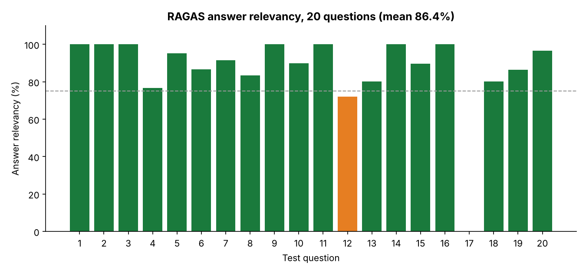

# UM-Dearborn AI Assistant

A Retrieval-Augmented Generation (RAG) chatbot for the University of Michigan-Dearborn. Scrapes the official university website, embeds the content locally, and answers questions using a free Groq-hosted LLM — no OpenAI required.

## Architecture

```
frontend/index.html   ←  single-page chat UI
backend/server.py     ←  FastAPI REST API
backend/rag_engine.py ←  chunker · ChromaDB vector store · Groq LLM
backend/scraper_selenium.py  ←  curl_cffi concurrent scraper
```

**Stack:** Python · FastAPI · ChromaDB · sentence-transformers (`all-MiniLM-L6-v2`) · Groq (Llama 3) · vanilla HTML/CSS/JS

## Quickstart

### 1. Clone & install

```bash
git clone https://github.com/omshivbhosale/UM-Dearborn-RAG.git
cd UM-Dearborn-RAG
python -m venv venv && source venv/bin/activate   # Windows: venv\Scripts\activate
pip install -r requirements.txt
```

### 2. Configure environment

```bash
cp .env.example .env
# Edit .env and add your free Groq API key (https://console.groq.com)
```

### 3. Run the backend

```bash
cd backend
uvicorn server:app --reload --port 8000
```

### 4. Open the frontend

Open `frontend/index.html` in your browser (no build step needed).

### 5. Scrape & index

In the UI (or via curl):

```bash
# Scrape the UM-Dearborn website
curl -X POST http://localhost:8000/scrape -H "Content-Type: application/json" \
     -d '{"max_pages": 200}'

# Wait for scraping to finish, then index
curl -X POST http://localhost:8000/index
```

Once indexing is done, the chat is ready.

## API Endpoints

| Method | Path | Description |
|--------|------|-------------|
| GET | `/` | Health / version |
| GET | `/health` | Status + chunk count |
| POST | `/chat` | Ask a question |
| POST | `/scrape` | Scrape website (background) |
| GET | `/scrape-status` | Scrape progress |
| POST | `/index` | Embed & index pages (background) |
| GET | `/index-status` | Index progress |
| GET | `/search` | Raw vector search |
| POST | `/clear-memory` | Reset conversation history |

## Evaluation

Answers to 20 test questions about admissions, tuition, housing, programs, faculty and campus services were scored with [RAGAS](https://docs.ragas.io). The judge model is `llama-3.1-8b-instant` on Groq; embeddings are local. Questions are in `data/test_questions.json` and raw results in `data/eval_report.json`.

| Metric | Questions scored | Score |
|---|---|---|
| Answer relevancy (answer addresses the question) | 20 of 20 | **86.4%** |
| Context precision (retrieved chunks are relevant) | 1 of 20 | 80.4% (single question) |
| Context recall (retrieved text covers the reference answer) | 1 of 20 | 100% (single question) |
| Faithfulness (answer supported by retrieved text) | 0 of 20 | not scored |

Only answer relevancy has full coverage. The other three judge calls timed out on most questions (the Groq judge hit its limits), so their numbers are not meaningful and should not be read as results for the whole set. Re-running with a longer delay (`--delay 3`) or a stronger judge model would fill them in.



The lowest score is the NSF grant question (0.0): the assistant answered that it could not find the grant in the retrieved pages. The GPA question (0.72) is the next lowest.

To re-run (needs the scraped data, indexed, and a Groq key):

```bash
python scripts/run_pipeline.py   # end-to-end scrape -> index -> sample queries
python scripts/evaluate.py       # RAGAS metrics on data/test_questions.json -> data/eval_report.json
```

## Project Structure

```
├── backend/
│   ├── server.py           # FastAPI app
│   ├── rag_engine.py       # Core RAG logic
│   └── scraper_selenium.py # Web scraper
├── frontend/
│   └── index.html          # Chat UI
├── scripts/
│   ├── run_pipeline.py     # End-to-end pipeline runner
│   └── evaluate.py         # RAGAS evaluation
├── data/
│   ├── test_questions.json # evaluation questions (tracked)
│   ├── eval_report.json    # RAGAS results (tracked)
│   ├── scraped_pages.json  # gitignored, created at runtime
│   └── chroma_db/          # gitignored, created at runtime
├── doc_assets/             # Charts & diagrams
├── .env.example            # Template — copy to .env
└── requirements.txt
```
